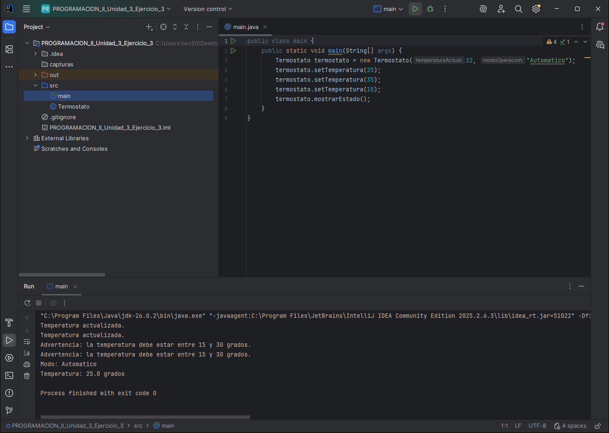

# PROGRAMACIÓN II — Unidad 3, Ejercicio 3: El Termostato Inteligente y sus Rangos de Temperatura

Trabajo práctico de Programación II. Este repositorio contiene la resolución en Java del ejercicio 3 de la Unidad 3.

## Consigna

#### Contexto

Un dispositivo físico como un termostato digital maneja un rango de operación específico (por ejemplo, entre 15°C y 30°C). Si se permitiera modificar la temperatura directamente sin restricciones, el sistema podría sufrir fallas operativas. El encapsulamiento garantiza que el estado del dispositivo se mantenga siempre dentro de parámetros seguros.

#### Consigna

Construir una clase en Java que modele un termostato, protegiendo su temperatura interna y aplicando restricciones estrictas ante cualquier intento de cambio.

#### Desarrollo requerido

- Definir la clase Termostato con atributos privados temperaturaActual y modoOperacion.
- Implementar el método setTemperatura(double nuevaTemperatura) que incluya una validación para rechazar valores que se encuentren fuera del rango permitido (15°C a 30°C), imprimiendo un mensaje de advertencia.
- Proveer el método getTemperatura() para consultar el estado actual de manera segura.
- En el método main, instanciar el termostato, intentar establecer temperaturas válidas e inválidas, y reflejar el comportamiento por consola.

## Estructura del repositorio

```
PROGRAMACION_II_Unidad_3_Ejercicio_3/
├── README.md
├── capturas/
│   └── consola.png
└── src/
    ├── main.java   # clase con el método main
    └── Termostato.java
```

## Funcionamiento y lógica

El ejercicio aplica **encapsulamiento** para que la temperatura del termostato nunca salga de un rango seguro.

### `Termostato`

Tiene los atributos privados `temperaturaActual` y `modoOperacion`.

- **Constructor:** guarda el modo y carga la temperatura inicial a través de `setTemperatura()`, así también pasa por la validación.
- **`setTemperatura(double)`:** solo acepta valores entre **15 y 30 grados**. Si el valor está en el rango lo guarda; si no, muestra una advertencia y conserva la temperatura anterior.
- **`getTemperatura()`:** devuelve la temperatura actual.
- **`mostrarEstado()`:** imprime el modo y la temperatura.

### `main`

Crea un termostato en modo "Automatico" a 22 grados y prueba tres cambios: 25 (se acepta), 35 y 10 (se rechazan por estar fuera del rango). El estado final queda en **25 grados**.

## Ejecución

Captura de la consola de IntelliJ IDEA ejecutando el programa:



Salida obtenida:

```
Temperatura actualizada.
Temperatura actualizada.
Advertencia: la temperatura debe estar entre 15 y 30 grados.
Advertencia: la temperatura debe estar entre 15 y 30 grados.
Modo: Automatico
Temperatura: 25.0 grados
```
